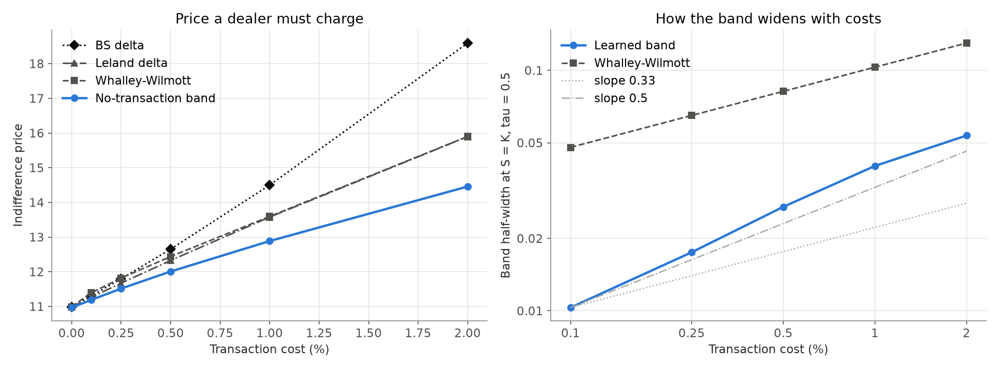
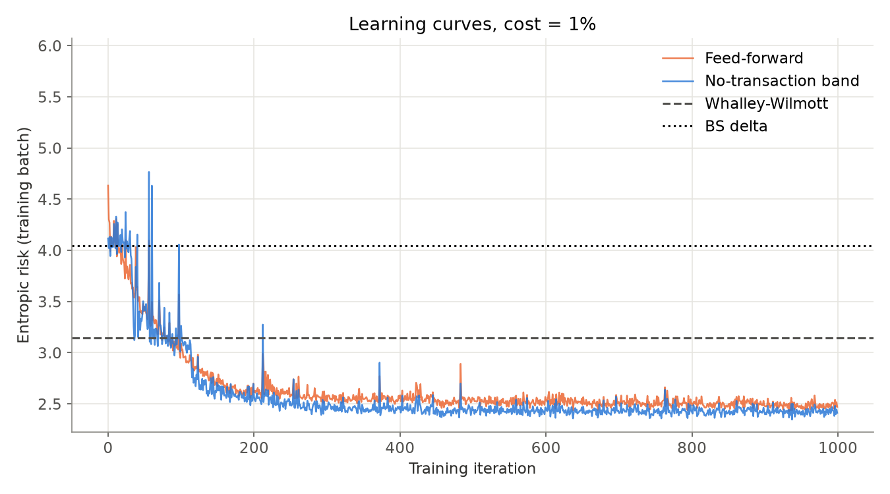
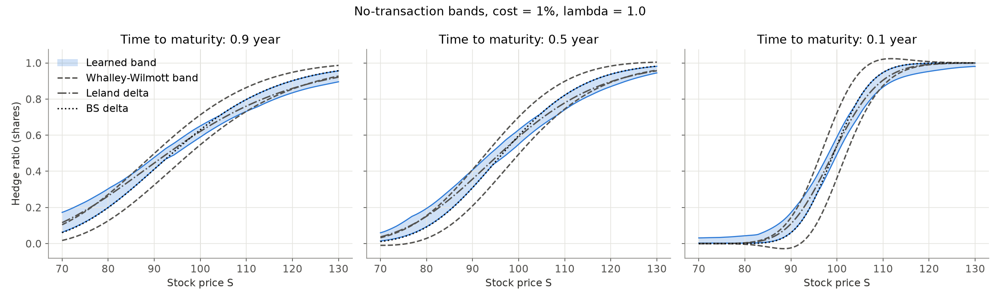

# Deep Hedging with Transaction Costs

**Project 3, part B.** Part A ([`../rl_hedging`](../rl_hedging)) tried to hedge an option with reinforcement learning (PPO). Part B trains the hedging strategy directly on the risk of the final P&L, following *Deep Hedging* (Buehler et al., 2019) and the *No-Transaction Band Network* (Imaki et al., 2021). It then compares the result against the classical answers to the same problem.



**Result.** A dealer sells a one-year at-the-money call and pays 1% on every share traded. To accept the trade, they need a premium of:

| Strategy | Premium needed |
|---|---|
| Black–Scholes delta hedging | **14.50** |
| Best classical method (Leland, Whalley–Wilmott) | **13.58** |
| Learned no-transaction band network | **12.88** |

The Black–Scholes price is 10.45. The network beats every benchmark at every cost level tested, and the gap grows with costs: −0.69 vs the best benchmark at 1%, −1.44 at 2%. The result holds on 5 out of 5 training seeds.

---

## 1. Setup

**Market.** The stock follows a geometric Brownian motion, simulated with the exact log-discretisation under the risk-neutral drift:
- S₀ = K = 100, σ = 20%, r = 5%, T = 1 year;
- 50 rebalancing dates (Δt = 0.02).

Every strategy is tested on the **same 20,000 paths** (seed 99). The networks are trained on fresh paths drawn at every iteration.

The data is simulated on purpose. When the true model is known, the classical strategies are exact references, so any improvement can be attributed to the strategy and not to model error. Real data is listed under extensions.

**P&L.** The dealer is short one call and holds $h_i$ shares between dates $t_i$ and $t_{i+1}$. Prices are discounted to time 0 ($\tilde S_i = e^{-rt_i} S_i$), so financing the stock position is accounted for:

```math
\text{PnL} = p + \sum_{i=0}^{n-1} h_i (\tilde S_{i+1}-\tilde S_i) - c\sum_{i=0}^{n-1} |h_i-h_{i-1}| \tilde S_i - e^{-rT}(S_T-K)^+,
\qquad h_{-1}=0
```

- $p$ is the premium received and $c$ the proportional cost (1%).
- The position is not unwound at maturity: the option is assumed to be physically settled.

**Risk measure and price.** Strategies are ranked by the **entropic risk** with risk aversion λ = 1:

$$
\rho(X) = \tfrac{1}{\lambda}\log \mathbb{E}\big[e^{-\lambda X}\big]
$$

It penalises losses exponentially, so tail losses dominate. It is computed with `logsumexp` for numerical stability.

Since $\rho(X + p) = \rho(X) - p$, the **indifference price** is $p^{*} = \rho(\text{PnL} |_{p=0})$: the smallest premium that makes the dealer's risk zero. Minimising risk and minimising the premium a dealer has to charge are the same problem. This is the number the tables report.

## 2. Strategies compared

| Strategy | Rule | Source |
|---|---|---|
| **BS delta** | $h = \Delta_{BS}(S,\tau)$: rebalance to the Black–Scholes delta at every date | Black–Scholes |
| **Leland delta** | BS delta computed with an inflated volatility, $\sigma_L = \sigma\sqrt{1 + \sqrt{2/\pi} \frac{2c}{\sigma\sqrt{\Delta t}}}$ (25% at 1% cost) | Leland (1985) |
| **Whalley–Wilmott** | Trade only when the position leaves the band $\Delta_{BS} \pm \big(\tfrac{3}{2} c e^{-r\tau} S \Gamma^2/\lambda\big)^{1/3}$, and then only back to its nearest edge | Whalley & Wilmott (1997) |
| **Feed-forward network** | $h = \Delta_{BS} + \tanh\big(\text{MLP}(\log\tfrac{S}{K},\ \tfrac{\tau}{T},\ h_{\text{prev}})\big)$ | Buehler et al. (2019) |
| **No-transaction band network** | The MLP outputs a band $[\Delta_{BS} - \text{LeakyReLU}(a),\ \Delta_{BS} + \text{LeakyReLU}(b)]$; then $h = \text{clamp}(h_{\text{prev}},\ \text{band})$ | Imaki et al. (2021) |

**Both networks:**
- MLP with 4 hidden layers of 32 units and ReLU: 3,329 and 3,330 parameters.
- Adam, learning rate 10⁻³, 1,000 iterations of 10,000 fresh paths.
- Trained by back-propagating the entropic risk through all 50 hedging dates.

**Why the band network helps.** Its MLP never sees the previous position. It only decides *where the band is*; the clamp then gives the "do nothing inside the band, trade to the nearest edge outside" behaviour exactly. The feed-forward network has to learn that behaviour from $h_{\text{prev}}$, and only manages it approximately.

## 3. Results at 1% transaction cost

Evaluated on the same 20,000 test paths. The P&L columns assume the dealer receives the Black–Scholes premium (10.45); **Price** is the premium they actually need.

| Strategy | Price | CVaR 95% | Std P&L | Mean P&L | Turnover |
|---|---:|---:|---:|---:|---:|
| BS delta | 14.50 | −6.00 | 1.27 | −2.72 | 2.78 |
| Leland delta | 13.58 | −4.81 | 1.04 | −2.51 | 2.55 |
| Whalley–Wilmott | 13.59 | −5.05 | 1.66 | −1.35 | 1.35 |
| Feed-forward network | 12.95 | −4.25 | 1.35 | −1.67 | 1.68 |
| **No-transaction band network** | **12.88** | **−4.21** | 1.37 | −1.58 | 1.59 |

- **CVaR 95%** is the mean P&L of the worst 5% of paths.
- **Turnover** is the average number of shares traded per path.

How to read the table:

- **Mean P&L is negative for every strategy.** "Better" means a cheaper and safer hedge, not a profitable one. Hedging costs money, and the question is who loses the least, with the thinnest tail.
- **No Sharpe ratio.** For a hedger it is misleading: a strategy that doesn't hedge at all has a mean P&L around 0 and therefore the "best" Sharpe, with a tail seven times worse (section 6).
- **The two classical answers sit at opposite corners.**
  - Leland keeps trading continuously, with a better centre, and has the lowest variance.
  - Whalley–Wilmott trades half as much but keeps a wide band, so its P&L is noisier.
- **The band network gets both.** It has the best price and the best tail, with moderate turnover.

**Robustness over 5 training seeds** (initial weights and training paths both change, the test paths stay fixed):

| Model | Entropic risk (mean ± std) | Iterations to beat WW (mean) |
|---|---|---|
| No-transaction band network | **2.431 ± 0.002** | 63 |
| Feed-forward network | 2.514 ± 0.017 | 124 |

The band network is better on **5 out of 5 seeds**, with a paired gap of 0.083 ± 0.018. It is also about 8× less sensitive to initialisation. The structure built into the architecture does part of the learning for it, which also shows in how quickly it overtakes Whalley–Wilmott.

The "iterations to beat WW" column uses the smoothed training loss, so it is indicative only. The figures show the seed-0 model.



## 4. What the network learned



**Narrower than Whalley–Wilmott.** At the money, the learned band is 2.5 to 3.5 times narrower than the Whalley–Wilmott band:

| τ | Learned band | WW band |
|---|---|---|
| 0.9 | [0.588, 0.650] | [0.545, 0.711] |
| 0.5 | [0.548, 0.628] | [0.492, 0.698] |
| 0.1 | [0.489, 0.586] | [0.357, 0.718] |

Both widen as maturity approaches, because gamma, and therefore the cost of staying exactly on delta, grows near the strike.

**Not centred on the Black–Scholes delta.** The BS delta is the band's **lower edge** out of the money (S ≲ 90) and its **upper edge** in the money (S ≳ 105). The learned hedge is a delta flattened towards 0.5, which is the direction Leland's inflated volatility pushes it. This is why the Leland curve runs inside the band.

**The same pattern at every cost.** At S = 85 and τ = 0.5, the band's centre follows the Leland delta as costs rise:

| Cost | Learned centre | Leland delta | BS delta |
|---|---:|---:|---:|
| 0.1% | 0.210 | 0.191 | 0.184 |
| 0.25% | 0.216 | 0.202 | 0.184 |
| 0.5% | 0.224 | 0.218 | 0.184 |
| 1% | 0.240 | 0.245 | 0.184 |
| 2% | 0.261 | 0.287 | 0.184 |

**In one sentence:** the network rediscovered a combination of the two classical ideas, a Leland-type centre with a Whalley–Wilmott-type no-trade band, and calibrated the band much tighter.

(The Whalley–Wilmott band leaves [0, 1] near expiry because its width grows with gamma and the formula has no bound. It is plotted as the strategy actually trades.)

## 5. Cost sweep

The band network was retrained at each cost level. The benchmarks need no training.

| Cost | BS delta | Leland | Whalley–Wilmott | **Band network** |
|---|---:|---:|---:|---:|
| 0% | 10.99 | 10.99 | 10.99 | **10.97** |
| 0.1% | 11.31 | 11.26 | 11.40 | **11.19** |
| 0.25% | 11.80 | 11.67 | 11.82 | **11.52** |
| 0.5% | 12.65 | 12.33 | 12.44 | **12.01** |
| 1% | 14.50 | 13.58 | 13.59 | **12.89** |
| 2% | 18.59 | 15.90 | 15.90 | **14.46** |

(The 1% row comes from the sweep's own training run. It matches the section 3 model up to rounding.)

- **Sanity check at 0% cost.** The network is only 0.02 cheaper than the BS delta. With 50 discrete dates and an entropic objective, the BS delta is not exactly optimal, but almost: the network finds no free lunch where none should exist. The 0.54 gap between 10.99 and the Black–Scholes price of 10.45 is the risk premium for discrete-hedging error.
- **The advantage grows with costs.** It is 0.07 below the best benchmark at 0.1%, 0.69 at 1% and 1.44 at 2%.
- **Band width scaling** (right-hand panel, log-log):

  | Cost | Learned half-width | WW half-width |
  |---|---:|---:|
  | 0.1% | 0.010 | 0.048 |
  | 0.25% | 0.018 | 0.065 |
  | 0.5% | 0.027 | 0.082 |
  | 1% | 0.040 | 0.103 |
  | 2% | 0.054 | 0.130 |

  Whalley–Wilmott scales like $c^{1/3}$ by construction. The learned band scales like $c^{0.56}$ overall, flattening to about $c^{0.43}$ between 1% and 2%.

  This does not contradict Whalley–Wilmott. Their result is a small-cost, continuous-time asymptotic; here there are 50 discrete dates and costs up to 2%. The learned band is what is optimal at these finite costs, and its slope moving towards 1/3 as costs grow is consistent with that.

## 6. Part A revisited

Part B's evaluation code was used to re-test part A's PPO agents. Doing this revealed three problems in part A's accounting.

1. **No financing cost.** Part A's P&L counts stock price changes without the cost of borrowing to buy the shares. Holding stock therefore earns the drift r for free, which favours over-hedging and creates a positive mean P&L that is not real.
2. **One-period lag.** The hedge chosen at step t only starts earning at step t+1. Every decision is applied one period late, and the first period is always unhedged.
3. **Different test paths.** The PPO agents and the delta hedge were evaluated on different random paths, so the comparison mixed strategy and luck.

**Re-evaluation** (1% cost; same 20,000 paths and same P&L as section 3; the PPO agents receive exactly the observation they were trained on):

| Strategy | Price | CVaR 95% | Std P&L | Mean P&L | Turnover |
|---|---:|---:|---:|---:|---:|
| BS delta | 14.50 | −6.00 | 1.27 | −2.72 | 2.78 |
| PPO v1 (variance reward) | 32.62 | −17.40 | 6.11 | −2.76 | 2.92 |
| PPO v2 (CVaR reward) | 106.89 | −41.84 | 14.55 | +0.04 | 0.00 |
| No-transaction band network | **12.88** | **−4.21** | 1.37 | −1.58 | 1.59 |

**PPO v1.** Its positive mean in part A (+0.38) disappears once the stock position has to be financed: it is now −2.76. Its tail is three times worse than the BS delta's.

Inspecting the policy shows why. Its raw output follows moneyness but is much steeper than delta: 0 below S ≈ 85, full hedge above S ≈ 115, roughly delta at the money. It also adds about +0.5 × the previous position. So it learned that inertia saves costs, a crude version of the no-trade band, but through a noisy per-step reward.

**PPO v2 does not hedge at all.** Its results are identical to "no hedge" to the last digit. The diagnosis ([`src/09_diagnose_ppo.py`](src/09_diagnose_ppo.py)):

- **The Gaussian policy's mean μ is negative in every state** tested (−0.95 to −0.31), so the clipped action is always 0.
- **μ does not increase with S.** If anything it decreases slightly, the opposite of a hedge.
- **Its standard deviation stayed at 0.92**, close to its initial value of 1, while PPO v1's fell to 0.38. The policy barely trained.

The likely mechanism is reward design:

- The −cost penalty at each step is a clean signal that pushes μ down.
- The terminal 2·loss² penalty is too large and noisy for PPO to attribute to individual decisions.
- Once μ is below 0, almost every sampled action is clipped to 0, so the episodes look the same and the policy stops improving.

**Takeaway.** Part A's README said that PPO "beats the delta hedge on Sharpe" and that the CVaR agent "maximises mean P&L". Neither holds under correct accounting. Part B's approach, an exact gradient of the risk of the *whole* P&L through all 50 decisions, fixes the problem part A ran into with credit assignment, and the structured architecture fixes sample efficiency.

## 7. Limitations and extensions

- **Model.** Only GBM with a known volatility, one option (an ATM call) and one risk aversion (λ = 1).
- **Real data.** The next step is to train and test on SPY paths, or bootstrapped returns, to see how much of the gain survives model error.
- **Risk aversion.** Sweep λ (0.1 and 0.01). Whalley–Wilmott's width scales like λ^{−1/3}; does the learned band follow?
- **Stochastic volatility.** Use Heston paths, with the variance as an input to the network, where the classical benchmarks are no longer optimal.
- **PPO done right.** Retrain PPO in the corrected environment with a terminal-only entropic reward, to separate "RL is the wrong tool" from "the environment was wrong".

## 8. Reproduce

Python 3.12 with `torch`, `numpy`, `pandas` and `matplotlib`. `stable-baselines3` is needed only for scripts 08 and 09. Run every command from this folder:

```bash
python src/01_baselines.py         # classical strategies, seconds
python -u src/02_train.py          # both networks at 1% cost, ~7 min on a laptop CPU
python src/03_plot_band.py         # bands_0.01.png
python src/04_compare.py           # main comparison table
python -u src/05_seeds.py          # 5 seeds x 2 networks (10 trainings)
python -u src/06_cost_sweep.py     # retrain the band network at 6 cost levels, writes the CSVs
python src/07_plot_sweep.py        # cost_sweep.png (from the CSVs, no retraining)
python src/08_part_a_reeval.py     # part A agents under part B's accounting
python src/09_diagnose_ppo.py      # inside the PPO policies
```

Everything is seeded. Re-running gives the same numbers (float32 on CPU), and `02_train.py` reproduces seed 0 of `05_seeds.py` exactly.

```
src/
  config.py                  all parameters in one place
  utils/market.py            GBM simulation (NumPy and PyTorch)
  utils/black_scholes.py     price, delta, gamma (differentiable, torch)
  utils/hedging.py           market state + self-financing P&L simulator
  utils/strategies.py        BS delta, Leland, Whalley-Wilmott
  utils/risk.py              entropic risk, CVaR, indifference price
  utils/models.py            feed-forward hedger, no-transaction band network
  utils/training.py          training loop and evaluation
  utils/style.py             shared figure style
  01 ... 09                  experiments, in order
tests/                       step-by-step checks of each building block
data/results/                CSVs, saved models, figures
```

## References

- H. Buehler, L. Gonon, J. Teichmann, B. Wood. *Deep hedging.* Quantitative Finance 19(8), 2019.
- S. Imaki, K. Imajo, K. Ito, K. Minami, K. Nakagawa. *No-Transaction Band Network: A Neural Network Architecture for Efficient Deep Hedging.* arXiv:2103.01775, 2021; Journal of Financial Data Science, 2023.
- A. E. Whalley, P. Wilmott. *An asymptotic analysis of an optimal hedging model for option pricing with transaction costs.* Mathematical Finance 7(3), 1997.
- H. E. Leland. *Option pricing and replication with transactions costs.* Journal of Finance 40(5), 1985.